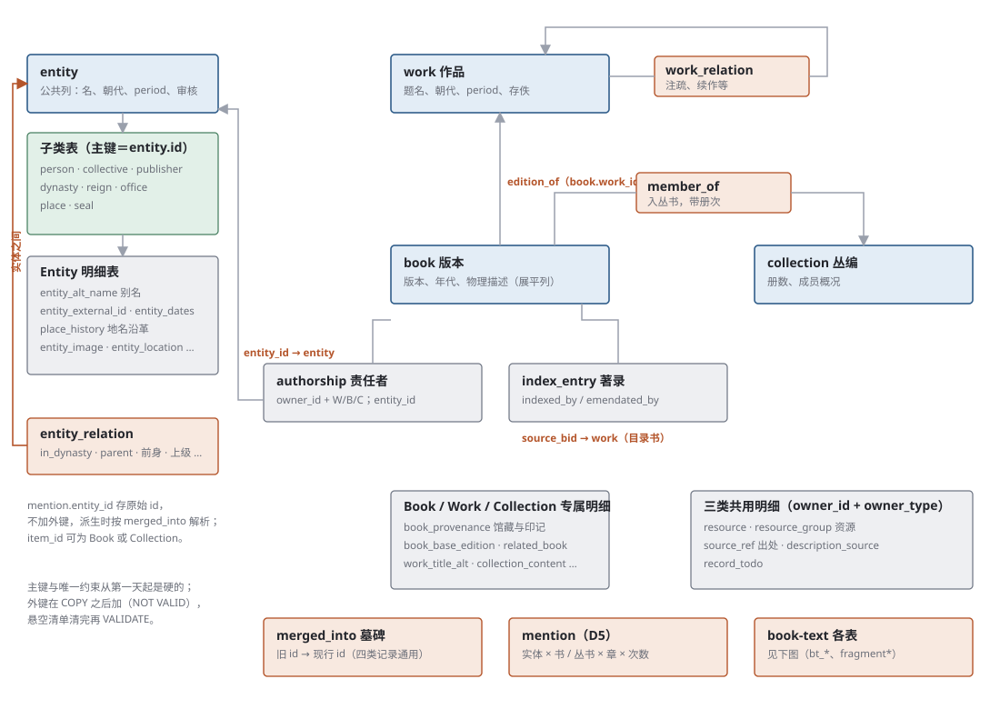
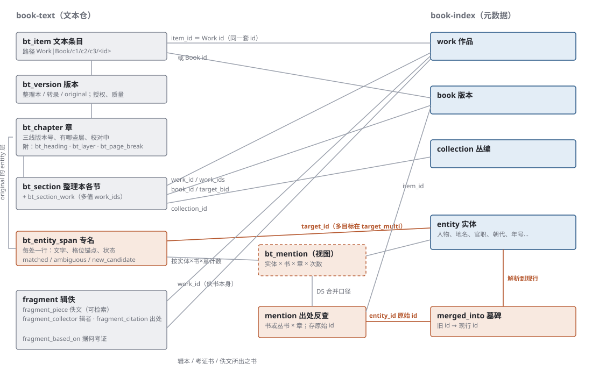

# 规范化数据库表结构（D1 草案）

> A11，2026-11-02。GUJI-755（链 GUJI-252）。方案来源：ai-team `domain/目录与资源/设计/2026-11-规范化数据库方案-交A11.md`。
> 状态：**草案，待 A12、A33、A42 评审**；本目录只含表结构与说明，不改任何数据、不改 JSON schema。

## 定位
git 里的 JSON 仍是唯一真源。数据库由 bim 从 JSON 生成（D2），随时可重建；派生文件（D3）与检索从库出。三个文件按序执行：[schema.sql](schema.sql)（建表与索引，需 `pg_trgm`）→ COPY 灌库 → [constraints.sql](constraints.sql)（外键，`NOT VALID`）→ [checks.sql](checks.sql)（悬空与口径检查，应全为 0 行）→ 清干净后逐条 `VALIDATE CONSTRAINT`。已在 PostgreSQL 16 试建通过。明细表对主表的外键是内联硬约束，COPY 顺序须先主表、后明细表；`bt_mention` 是物化视图，灌完后 `REFRESH MATERIALIZED VIEW bt_mention`。

## 关系图

## 设计原则
1. **每类记录一张主表**：`work`、`book`、`collection`、`entity`；Entity 另有 8 张子类表（`person` `collective` `publisher` `dynasty` `reign` `office` `place` `seal`），主键即 `entity.id`。
2. **数组对象 → 明细表**（`owner_id + seq` 保序）：别名、馆藏（`book_provenance`）、底本、附刻、地名沿革、图片等，只属一条主记录。
3. **多类共用的对象 → 共用明细表**：`authorship`（责任者）、`index_entry`（`indexed_by` / `emendated_by`，`kind` 区分）、`resource` / `resource_group`、`source_ref`、`merge_event`（`merged_in` / `merged_from` / `merge_history`）。以 `owner_id + owner_type(W/B/C)` 指向主记录。
4. **跨记录引用 → 关系表，每种关系只存一遍**：`authorship.entity_id`（作者）、`book.work_id`（版本→作品）、`member_of`（入丛书，带册次）、`work_relation`（注疏续作等）、`entity_relation`（朝代／上下级／前身／印主等）、`merged_into`（并条账：旧 id→现行）、`bt_mention`（book-text 专名出处，物化视图，见 book_text.sql）。正反向都靠索引查询。
5. **无损**：已知字段有类型化列；未登记的键进该行 `extra jsonb`。字段形状不规则的（如 `volume_index` 有整数／数组／字符串三种形）原样放 `jsonb`。**还原门禁**：从表拼回的 JSON 与原文件做规范化比较（键排序、数组按 `seq`）必须 100% 相同，否则 D2 不通过。
6. **类型与枚举**：年份、卷数、册数为数值；`edition_type`、`loss_status`、`attested_status`、各 `subtype` 为 Postgres 枚举（取值同 `schema/json`）。朝代名、`period`、`role` 等开放词表保持文本，不建枚举。
7. **外键两阶段**（按 A12 评审改）：外键不随建表，先 COPY，再加 `NOT VALID` 外键（不检查存量），跑 `checks.sql` 出悬空清单，清干净再 `VALIDATE` 改为硬拦。主键与唯一约束从第一天起就是硬的。
8. **正式库与草稿库同构**：用 `repo` 列区分（`index` / `draft`）；草稿记录可指正式 id（`authors[].entity_id`），所以跨 repo 的外键不加，只在检查脚本里按 repo 分别体检。

## 与 JSON 字段的对应（要点）
| JSON | 落点 |
|---|---|
| `authors[]` | `authorship` |
| `indexed_by[]` / `emendated_by[]` | `index_entry` |
| `resources[]` / `resource_groups` | `resource` / `resource_group`（`group`→`grp`；`volumes`、`metadata` 为 jsonb） |
| `sources[]` | `source_ref`（字符串旧写法进 `raw`） |
| `merged_in` / `merged_from` / `merge_history` / `merged_into` | `merge_event`、`merged_into` |
| Work `related_works[]` | `work_relation` |
| `contained_in[]`（Work/Book/Collection） | `member_of` |
| Book `provenance[]` | `book_provenance`（`seals` 数组、`seal_marks` jsonb） |
| Book `publication_info` / `dating` / `physical_description` | `book` 上展平的列 |
| `description{text,sources}` | `*.description_text` ＋ `description_source` |
| Entity `alt_names[]`、`history[]`、`dates`、`external_ids` | `entity_alt_name`、`place_history`、`entity_dates`、`entity_external_id` |
| Entity `dynasty_ids`/`predecessors`/`superiors`/`owner_ids`/`group_ids`/`owners`/`institution_ids` | `entity_relation`（`rel` 区分） |
| Work `version_graph`、`title_emendation`、`collection_scale` | 各 jsonb 列（共 10 条以内的长尾，不拆表） |

## 评审后的修订（A12，2026-11-02）
外键移出 schema.sql；`floruit` 拆两列；`entity_external_id` 加 `seq`（`cbdb_id_alt` 为数组）；补列：office/collective 的 `function` `basis` `institution_ref`、collective/publisher 的 `start_year`、place 的 `concept_id`、`place_history.dynasty_ids`；`parent_id`（office/collective/dynasty）进 `entity_relation(rel='parent')`，`rel` 为封闭词表，`dynasty_of` 改名 `in_dynasty`；去掉各主表 `merged_into` 列（只留 `merged_into` 表）；dynasty/reign 起止年只留 `entity_dates`；所有明细表都有 `extra jsonb`；`mention.book_id` 改 `item_id` 且无外键、`entity_id` 存原始 id；checks 增加 owner_type 一致与 id 跨类唯一。

## book-text 的表（[book_text.sql](book_text.sql)）
book-text 与 book-index 同一套 id，进同一个库，表名加 `bt_` 前缀（辑佚为 `fragment*`），共 20 张＋1 个物化视图：

| 层 | 表 | 来自 |
|---|---|---|
| 条目与版本 | `bt_item`、`bt_version`、`bt_juan_group` | `manifest.json`、`<版本>/index.json` 顶层 |
| 章 | `bt_chapter`（含有哪些层、三线版本号、校对中）、`bt_heading`、`bt_page_break`、`bt_layer`、`bt_change` | `index.json` 的 `chapters[]`、`pages.tsv`、各伴生层文件头、`CHANGES.md` |
| 整理本结构与链接 | `bt_section`、`bt_section_work` | 整理本 `NNN.json` 的 `sections[]`（`work_id`／`work_ids`／`book_id`／`collection_id`／`target_bid`） |
| 专名 | `bt_entity_span`、`bt_entity_span_target`（一处对多目标），物化视图 `bt_mention` | original 的 `NNN.entity.json` `entities[]` |
| 辑佚 | `fragment`、`fragment_based_on`、`fragment_collector`、`fragment_collector_section`、`fragment_piece`（佚文正文，可检索）、`fragment_piece_collector`、`fragment_citation` | `fragments/<书名>.json` |
| 其他文件 | `bt_file` | `sources/`、`extra/`、`fig/`：只登记路径 |

不进库：正文 `NNN.md`、char 每格字、cord 像素框、punct 每个标点、norm 条目、图片、抓取素材。库里只记「有没有、什么版本、链到哪」。正文要不要进库做全文检索，单独定（影响库大小与 Neon 费用）。
原 `book_text` 表取消，由 `bt_version` 代替；`mention` 表保留给 A12 出处反查的其他来源，D5 与 `bt_mention` 合并口径。

## 据 S2（Book 审查）的修订（2026-11-02）
`juan_number` 改 int（三张主表）；`dating_based_on`、`dating_later_repair` 改 jsonb（实为对象）；`volume_count` 与 `page_count` 统一为 jsonb；`dating_year_range` 加二元 CHECK；新增 `measure`（`measures[]`，三类共用）、`book_seal_mark`（印记 → seal 实体）、`book_relation`（`lineage.derived_from`／`related_to` 的 Book→Book 边）。报告：`/mnt/project-files/总目/schema审查/S2-Book.md`。列名前缀（`pub_*` 对 `publication_info`）等命名问题留待总报告统一定。

## 据 S3（共用对象）、S4（Entity）审查的修订（2026-11-02）
- **草稿库**：现存几乎全是 `{schema_version,id,type,title}` 空壳。空壳（无实质字段、也无 `merged_into`）不灌；**并条账一条不丢**：现存墓碑照灌（主表一行＋`merged_into` 表一行）；11-01 起正式库墓碑已大批清掉（#2124、#2126），旧 id 只剩台账 `.claude/qa/purge-tombstones/ledger/*.tsv`，装载时一起装进 `merged_into`（11-03 A12 修正，见下节）；`revision` 改为可空（草稿多数没有）。
- `updated_at` 改 `text`：数据里有只写日期、带 `Z`、带偏移三种写法，存 timestamptz 会破坏还原。
- `merge_event` 加 `primary_name`（Entity 并条记录的名字）；`work`、`collection` 补 `juan_source`；`book`、`collection` 补 `review_status`。
- `entity_todo` 并入 `record_todo`，`entity_description_source` 并入 `description_source`（四类共用）。
- Entity：`relations[]` 进 `entity_relation(rel='person')`（`kind`=亲属师承类型，`note`=依据）；`entity_relation` 加 `start_year`／`end_year`；`reign.dynasty_id` 改走 `in_dynasty`，`office.institution_ref` 改走 `institution`（与 seal 一致）；起讫年统一只在 `entity_dates`；`status` 移到 `publisher`；`place_history.dynasty_ids` 改为关系表 `place_history_dynasty`（可按朝代反查地名）；去掉 `raw_string`（实测 0 条）。
- `index_entry.source_bid` 实测全部指 Work、悬空 0，外键可直接 VALIDATE。
报告：`/mnt/project-files/总目/schema审查/S3-共用对象与旧字段.md`、`S4-Entity.md`。

## 据 S1（Work／Collection）、S6（book-text）审查与 A12 意见的修订（2026-11-02）
- `work_relation.dst` 去掉外键：`collected_in`（80）、`studies`（1）指 Collection，checks 合查 Work 与 Collection。`collection.work_id`、`related_collection.dst` 加外键；`member_of` 加 `orig_order`（从 `details`「叢編原序 N」抽出）。
- `entity_relation` 加 `sources`（关系只录明载并注出处，用户 11-02 定）；`person` 关系双向都存，与文件一致。
- 删 `mention` 表，出处反查统一用物化视图 `bt_mention`。
- book-text：删未用的 `bt_kind` 枚举（`kind` 取 manifest 原值）；`bt_version` 加 `edition_label`、`note`、`fetched_at`，`references_` 改 `ref_sources`；`bt_chapter` 补 `md_len`、`page_title`、`revid`、`juan`、`volume`、`pdf_pages`、`has_table`；`bt_layer` 加 `review`（验收记录）；`bt_juan_group` 加 `parent_seq`；`bt_change` 的「冊」栏拆 `target_item`＋`ch`，`line` 改 `track`；`bt_section` 补 `book_title`、`author`、`dynasty`、`edition`、`n_juan` 等高频列及 `has_work_id_key`；`via` 去掉 `part`；辑佚补 `heading`、`editor_note`、核验与 `statement_label` 等列，`fragment_piece` 主键改用数组位置 `idx`；checks 加 book-text 悬空检查（只报不挡）。
报告：`S1-Work与Collection.md`、`S6-book-text格式.md`（同目录）；A12 意见：ai-team `domain/专名/schema审查/S4-Entity-A12意见.md`。

## 据 A12、A33 对 S6 专名部分意见的修订（2026-11-03）
- `merged_into` 改为「并条账」：装现存墓碑＋清墓碑台账两个来源，加 `direct_into`（墓碑原写的去向）、`title`、`src`（来源）；`live_id` 一律解到链末。checks 加「终点必须是现行记录」。旧 id（网站旧链接、book-text 旧引用）都靠这张表解析。
- 墓碑清理脚本 `purge.py` 加保留类 **K**：book-text 的 JSON 里还引用的墓碑 id 不清，先在 book-text 改指。
- `bt_entity_span_target.target_id` 对应文件里的 `entity_id`。文件字段**暂不改名**（A12、A33：读者多，等专名 1.0 验收后随 entity v0.3 再议），库里列名用 `target_id` 只是表达「Work 或 Entity」；type=work 时它是 Work id。
- `target_coarse` 保留，取值只有 `part_of_work`（篇名暂挂上位书，A33 书名细配的标记）。book-text 专名 `type` 用 `people` 复数，与 Entity `subtype` 一致，不改。
意见原文：ai-team `domain/专名/schema审查/S6-book-text专名-A12意见.md`。

## 如何防止与 `schema/json` 漂移
D2 起由 bim 里的一份拆表映射（字段名 → 表／列）驱动建库与还原，并加一条 CI 检查：`schema/json` 里出现映射里没有的字段时报错，逼人要么登记列、要么确认放 `extra`。DDL 以后由映射生成，本目录 `schema.sql` 届时改为生成物。

## 待评审的几个点
1. 是否同意 `authorship` / `index_entry` / `resource` 采用 `owner_id+owner_type` 的多态明细表（省表但无法做外键）；备选是按三类各一张。
2. `book` 上展平 `publication_info`/`dating`/`physical_description` 约 20 列，是否可以接受。
3. `entity_relation` 把 7 种小关系并成一张（用 `rel` 区分）是否可以；备选是拆成独立关系表。
4. `period`、`dynasty` 保持文本，不建朝代外键，是否同意（A12 的朝代 Entity 与 `period` 口径另有工作在做）。
5. 本草案没有改任何现有字段名与口径；如发现 schema 口径需要调整，另开卡，先通知 A12、A33、A42。

## 下一步（D2）
bim 加 `book-index db build`：JSON → 行 → COPY；还原门禁；按 `git diff` 增量。全量目标 ≤ 3 分钟。
